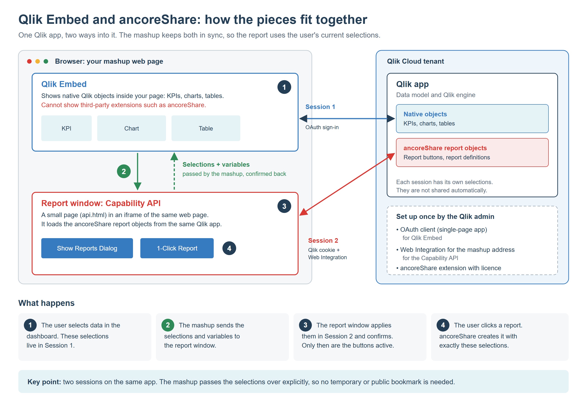

# Qlik Embed mashup with ancoreShare reports

A reference mashup that embeds Qlik Cloud objects with Qlik Embed and lets users create ancoreShare reports from the mashup. The user's current selections and a variable are passed to the report, so the report uses the same context the user sees in the dashboard.

Built with Vite, React, TypeScript, Tailwind CSS and shadcn/ui. The saved Qlik app is not changed.

## Why this approach

Qlik Embed does not render third-party extensions such as ancoreShare. This mashup therefore loads the ancoreShare report objects through the Capability API in a same-origin iframe (`public/api.html`). The dashboard transfers active selections and the variable value explicitly to that iframe before the report buttons become available. No temporary or public bookmarks are needed.



The same picture as vector graphic: [docs/qlik-embed-ancoreshare-overview.svg](docs/qlik-embed-ancoreshare-overview.svg)

## Prerequisites

- A Qlik Cloud tenant with the app you want to embed.
- ancoreShare installed on that tenant, with a licence.
- An OAuth client of type single-page app (SPA) for Qlik Embed. Add your mashup origin and `/oauth_callback.html` as allowed redirect.
- A Web Integration that allows your mashup origin. The Capability API and ancoreShare exports use it.
- Node.js 22.12 or newer.

## Configuration

Replace the placeholders with your own values. All of them are in these files:

| Placeholder | Meaning | Files |
| --- | --- | --- |
| `your-tenant.eu.qlikcloud.com` | Your Qlik Cloud tenant host | `src/lib/qlik.ts`, `public/api.html` (3 places), `public/oauth_callback.html` |
| `YOUR-APP-ID` | ID of the Qlik app | `src/lib/qlik.ts`, `public/api.html` |
| `YOUR-OAUTH-CLIENT-ID` | Client ID of the OAuth SPA client | `src/lib/qlik.ts` |
| `YOUR-WEB-INTEGRATION-ID` | ID of the Web Integration | `public/api.html` |

The tests use the same placeholders. If you replace them there too, keep the values consistent.

To find any placeholder you missed:

```sh
grep -rn "your-tenant\|YOUR-" src public
```

### Qlik objects

The object IDs below come from the example app. Replace them with the IDs from your app.

| Object | Example ID | File |
| --- | --- | --- |
| KPIs (six) | `pQam`, `jmhMcE`, `WNhGuc`, `PucAVn`, `jJqEnj`, `TwYTvA` | `src/lib/qlik.ts` |
| Chart | `mJHysa` | `src/App.tsx` |
| Table | `DtNjLk` | `src/App.tsx` |
| ancoreShare report | `dRenfA` | `public/api.html` |
| ancoreShare context report | `CJjxGy` | `public/api.html`, `src/components/report-window.tsx` |

The example passes a numeric variable named `vTest`. Rename it in `src/App.tsx`, `src/lib/selection-context.ts`, `src/lib/report-sync.ts` and `public/api.html` if your report uses a different variable.

The session identity (`dummy-dashboard` in `src/lib/qlik.ts`) is an application-defined session key, not a credential.

## Report actions

- **Show Reports Dialog** opens the report window with the native ancoreShare buttons, so the user can choose a report.
- **1-Click Report** opens the same window and starts the context report directly, after authentication and after the latest context has been acknowledged.

The report window stays visible for ancoreShare progress, errors and downloads. The dashboard stays usable while it is open. Do not change selections during an export unless you have verified the report's background execution behaviour.

### Close the window automatically after the report

In the context report object, set **Report & Page → Report Events → On After Report** to this Qlik expression (or append it to existing event code):

```qlik
='if (window.ancoreShareReportBridge) {
  window.ancoreShareReportBridge.afterReport("CJjxGy");
}'
```

Use your own object ID instead of `CJjxGy`. In a normal Qlik sheet the call does nothing. Without the hook, the user closes the window with X.

## Authentication

The dashboard uses OAuth SPA. The report iframe uses an interactive Qlik cookie session with the Web Integration and a CSRF token. Both must use the same tenant, app and user.

If the report session is missing, the user signs in to Qlik in a new tab with the same account and chooses **Try again**. Private browsing or strict browser policies can block the required cookies even when the dashboard works.

`public/api.html` sets `window.config` before ancoreShare loads, because ancoreShare reads the Web Integration ID from there. Keep this order. No tokens or cookies are sent in the context messages between dashboard and iframe.

## Development

```sh
npm ci
npm run dev
```

Open `http://localhost:8080/dashboard.html`. Port 8080 is fixed so the OAuth origin does not change. Add `http://localhost:8080` to the OAuth client and the Web Integration for local testing.

```sh
npm test
npm run build
npm run preview
```

## Deployment

`npm run build` writes the site to `dist/`. Host it on any static web host under the origin you allowed in the OAuth client and the Web Integration. `public/api.html` and `public/oauth_callback.html` are copied unchanged.

## Code map

- `src/App.tsx`: layout, variable input, clear selections and app access errors.
- `src/components/qlik-object.tsx`: Qlik object lifecycle and loading and error states.
- `src/components/report-window.tsx`: floating report window and sign-in recovery.
- `src/lib/report-sync.ts`: serialized context transfer and acknowledgements.
- `src/lib/selection-context.ts`: reading selections and cleaning up temporary Qlik objects.
- `src/lib/qlik.ts`: tenant settings, object IDs and Qlik types.
- `public/api.html`: Capability API runtime for the ancoreShare report buttons.

More detail is in [QLIK-EMBED-CAPABILITY-REPORTS.md](QLIK-EMBED-CAPABILITY-REPORTS.md) and [implementation-guide.html](implementation-guide.html).

## Loading and errors

Skeletons cover initial loading. After 20 seconds a notice lets the Qlik UI stay visible. App permission errors show one **Access denied** message. Report startup and context acknowledgement each time out after 30 seconds, with retry inside the report window. A rendered report button alone does not prove that an export worked; test exports with a real user.

## Support

Questions about ancoreShare: support@ancoresoft.com

## License

MIT, see [LICENSE](LICENSE). ancoreShare itself is licensed separately.
